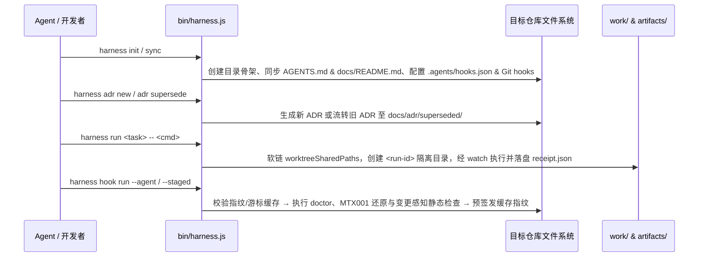

# 核心执行链路与数据流 (Core Data Flow)

> 本文件描述 `yoryon-harness` 的三条核心端到端主干链路（骨架同步、沙盒验收、门禁校验与指纹缓存）。

## 1. 端到端主干链路

## 2. 关键副作用与落盘边界

- **模板注入与钩子安装（[src/init.js](../../src/init.js)、[src/hook.js](../../src/hook.js)、[src/hook-script.js](../../src/hook-script.js)）**：写入或同步 `AGENTS.md`、`docs/README.md`、`.gitignore`、`.agents/hooks.json` 与 `.git/hooks/{pre-commit,reference-transaction}`；配置 `git config --local fetch.prune true` 并尝试开启 GitHub `deleteBranchOnMerge`。
- **隔离沙盒执行与回执（[src/run.js](../../src/run.js)、[src/watch.js](../../src/watch.js)）**：在 `work/<run-id>/` 与 `artifacts/<run-id>/` 执行命令，并在 `artifacts/<run-id>/receipt.json` 落盘退出码、耗时与产物摘要。
- **跨阶段验证缓存（[src/hook-tools.js](../../src/hook-tools.js)、[src/hook.js](../../src/hook.js)）**：将工作区树指纹、已验 `Stop` 游标（`lastPassedStepIndex`）写入 `<git-dir>/harness-verify-cache.json`，并在 `pre-commit` 无额外未暂存变更时通过 `git write-tree` 预签发提交后新树指纹。
