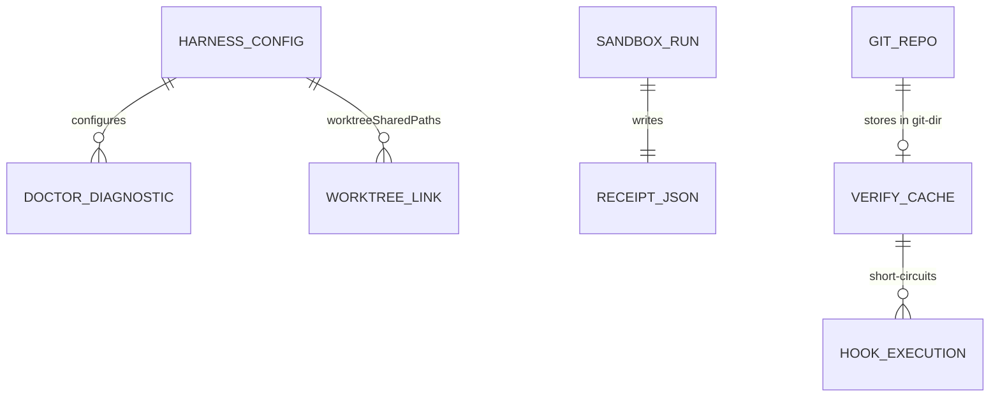
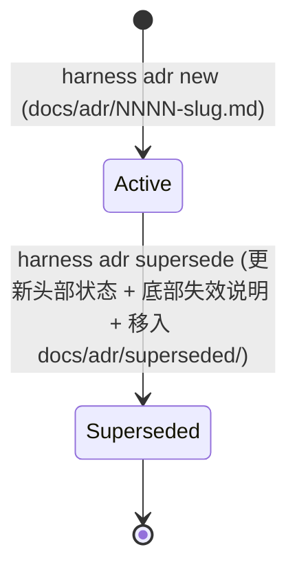
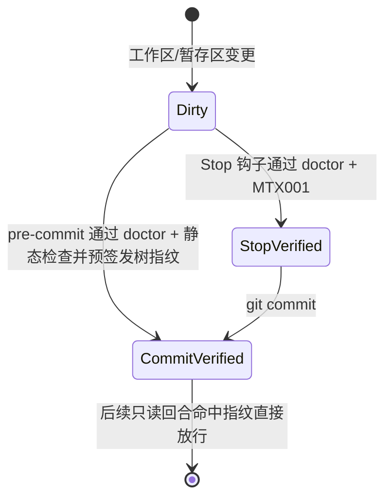

# 核心领域模型与状态机 (Data Model & State)

> 本文件描述 `yoryon-harness` 的核心配置/回执/缓存实体关系，以及 ADR 与 Worktree 的核心生命周期状态机。

## 1. 核心配置与运行时产物关系

## 2. 关键生命周期状态机

### 2.1 ADR 文档生命周期（[src/scaffold.js](../../src/scaffold.js)、[src/doctor.js](../../src/doctor.js)）

### 2.2 门禁缓存与分支/Worktree 回收状态（[src/hook.js](../../src/hook.js)、[src/clean.js](../../src/clean.js)）

## 3. 权威结构与配置索引

- **项目声明式配置（`.agents/harness.json`）**：读取与默认合并逻辑见 [src/doctor.js](../../src/doctor.js)（`loadHarnessConfig`）及 [src/clean.js](../../src/clean.js)。
- **诊断条目与规则表（`RULES` / `addDiag`）**：定义于 [src/doctor.js](../../src/doctor.js)。
- **沙盒执行回执（`receipt.json`）**：构造与落盘逻辑见 [src/run.js](../../src/run.js)。
- **跨阶段验证缓存（`<git-dir>/harness-verify-cache.json`）**：读写与指纹计算见 [src/hook-tools.js](../../src/hook-tools.js)。
