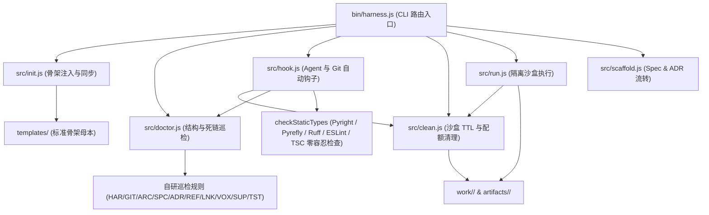
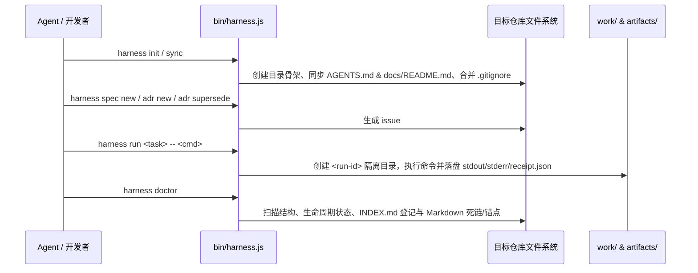

# 全局架构现状 (Architecture Overview)

## 1. 模块边界与源码地图

`yoryon-harness` 由**静态模板母本（`templates/`）**与**零依赖运行时 CLI（`bin/` + `src/`）**两部分组成：

- [bin/harness.js](../../bin/harness.js)：CLI 命令解析与子命令分发路由，不包含具体文件系统状态修改逻辑。
- [src/init.js](../../src/init.js)：负责 `harness init` 与 `harness sync`，从 [templates/](../../templates) 读取母本并向目标仓库写入目录与通用规范。
- [src/doctor.js](../../src/doctor.js)：负责 `harness doctor` 与 `harness rule`，执行目录契约、生命周期位置、三列索引、测试命名与反 Mock 契约（`TST001`/`TST002`）及 Markdown 本地死链/锚点检查。
- [src/hook.js](../../src/hook.js)：负责 `harness hook install` 与 `harness hook run --agent`，通过 Git `pre-commit` 与 Agent `Stop` 钩子自动清理过期沙盒产物、运行文档与测试契约巡检及多语言静态类型/Linter 检查（Pyright/Pyrefly/Ruff/ESLint/TSC），拦截违规并驱动模型自修复。
- [src/clean.js](../../src/clean.js)：负责 `harness clean` 及生命周期钩子触发的 `work/`、`artifacts/` 中间产物 TTL / 数量配额清理（保护 `.gitkeep` 与 `.gitignore`）。
- [src/run.js](../../src/run.js)：负责 `harness run`，接管验收命令的隔离沙盒目录创建、过期产物惰性清理、环境变量注入与回执落盘。
- [src/scaffold.js](../../src/scaffold.js)：负责 `harness spec new`、`harness adr new` 与 `harness adr supersede` 的确定性文档流转。

## 2. 核心执行链路与数据流

## 3. 系统不变量与边界约束

1. **非破坏性初始化与同步（[`src/init.js`](../../src/init.js)）**：
   - `harness init` 在未传 `--force` 时，严禁覆盖目标仓库已有的任何文件；`.gitignore` 采用按行去重追加策略确保 `work/` 与 `artifacts/` 被忽略。
   - `harness sync` 仅覆盖更新通用协议文件（`AGENTS.md` 与 `docs/README.md`），绝不触碰项目特异文件（`README.md`、`PROJECTS.md`、`CHANGELOG.md`、`docs/architecture/`、`docs/reference/INDEX.md`）。
2. **结构与链接完备性（[`src/doctor.js`](../../src/doctor.js)）**：
   - `SPC001`：`docs/spec/` 下所有条目必须为 `issue#<N>/` 目录且内部至少包含一份 `.md` 文档。
   - `ADR001` / `ADR002`：外层 `docs/adr/` 仅保留生效中的 `NNNN-<slug>.md`；状态为 `Superseded` 的决策必须移入 `docs/adr/superseded/`。
   - `REF001`：`docs/reference/` 下除 `INDEX.md` 外的任何文件必须在 `INDEX.md` 三列表格中登记。
   - `LNK001` / `LNK002`：所有 Markdown 本地文件链接必须精确匹配磁盘大小写路径，且 `#anchor` 必须匹配目标文档标题 Slug 或显式 HTML `id`。
   - `TST001` / `TST002`：`tests/` 下严禁使用阶段/序号命名测试文件（如 `test_phase1.py`、`test1.py`），Python 测试函数必须组织在 `class Test<Subject>:` 层级下并采用 `def test_<scenario>_<expected>()` 命名；测试代码中严禁使用 `unittest.mock`、`MagicMock`、`monkeypatch.setattr`、`jest.mock` 等伪造核心业务逻辑（放行 `monkeypatch.setenv`/`delenv` 环境变量隔离，合理例外须通过 `# harness-ignore TST002: 原因` 声明）。
3. **Agent Stop 钩子与静态类型零容忍拦截（[`src/hook.js`](../../src/hook.js)）**：
   - `harness hook run --agent` 仅在正常回合结束（`terminationReason == "NO_TOOL_CALL"`）时执行拦截，绝不阻塞用户手动取消（`USER_CANCELED`）或硬上限中断。
   - 自动探测目标仓库的多语言静态类型检查器与 Linter（Python `pyright` / `pyrefly` / `ruff`、JS/TS `eslint` / `tsc`），将静态类型与 Linter Error/Warning 与 `checkWorkspace` 诊断合并输出为 `{"decision": "continue", "reason": "..."}`。
4. **沙盒回执落盘（[`src/run.js`](../../src/run.js)）**：
   - 每次执行 `harness run <task> -- <cmd>` 均生成独立的 `<YYYYMMDD-HHmmss>-<task>` 运行 ID，并在 `artifacts/<run-id>/receipt.json` 中完整记录命令参数、起止时间、耗时、退出码及产物列表。
