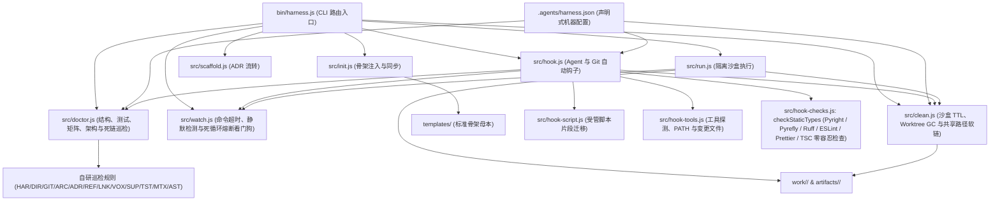

# 上下文与模块边界 (Architecture Overview)

> 本文件维护 `yoryon-harness` 的静态模块边界与源码入口地图。核心执行链路、领域模型与系统不变量分别维护在 [data-flow.md](data-flow.md)、[data-model.md](data-model.md) 与 [invariants.md](invariants.md)。

## 1. 模块边界与依赖拓扑

`yoryon-harness` 由**静态模板母本（`templates/`）**与**零依赖运行时 CLI（`bin/` + `src/`）**两部分组成：

## 2. 模块职责与源码入口地图

- [bin/harness.js](../../bin/harness.js)：CLI 命令解析与子命令分发路由，不包含具体文件系统状态修改逻辑。
- [src/init.js](../../src/init.js)：负责 `harness init` 与 `harness sync`，从 [templates/](../../templates) 读取母本并向目标仓库写入目录、通用规范及 Git / `.agents/hooks.json` 守护钩子。
- [src/doctor.js](../../src/doctor.js)：负责 `harness doctor` 与 `harness rule`，结合 `git ls-files -co --exclude-standard` 动态感知忽略规则，执行目录契约、固定架构槽位与防污染白名单（`HAR001`/`DIR001`）、ADR 生命周期位置（`ADR001`/`ADR002`）、三列索引（`REF001`）、多语言测试命名与反 Mock/超时/只读基线锁契约（`TST001`~`TST004`）、矩阵不可变列保护（`MTX001`）、声明式架构边界守卫（`AST001`/`AST002`）及 Markdown 本地死链/锚点检查（`LNK001`/`LNK002`）。
- [src/hook-script.js](../../src/hook-script.js)：按起止标记替换受管片段，旧版持久化 hook 仅按已发布格式迁移；未知旧片段拒绝覆盖，原文件保持不变，用户前后脚本逐字节保留。
- [src/hook-tools.js](../../src/hook-tools.js) 与 [src/hook-checks.js](../../src/hook-checks.js)：封装多语言工具探测、变更路径双集发现、验证缓存指纹与游标计算、Shell `-c` 解包，以及按语言变更门控并发调度的静态检查流程。
- [src/hook.js](../../src/hook.js)：负责 `harness hook install`、`harness hook pre-tool` 与 `harness hook run [--agent] [--staged] [--no-cache] [--full]`，协调多语言工具链 `PATH` 归一化、本地/远端分支清理配置、`PreToolUse` 看门狗拦截、`Stop` 轻量反作弊守卫与 `pre-commit` 单点重型静态门禁。
- [src/watch.js](../../src/watch.js)：负责 `harness watch` 进程组级总时长硬超时、静默挂起熔断、死循环刷屏熔断、TTY 重绘帧节流与宿主信号级联转发。
- [src/clean.js](../../src/clean.js)：负责 `harness clean`（含 `--worktrees`）的沙盒 TTL 回收、子 worktree 共享路径软链及孤儿/已合并 worktree 与分支安全回收。
- [src/run.js](../../src/run.js)：负责 `harness run` 隔离沙盒目录创建、共享路径软链、环境变量注入与回执落盘。
- [src/scaffold.js](../../src/scaffold.js)：负责 `harness adr new` 与 `harness adr supersede` 的确定性 ADR 文档流转。
