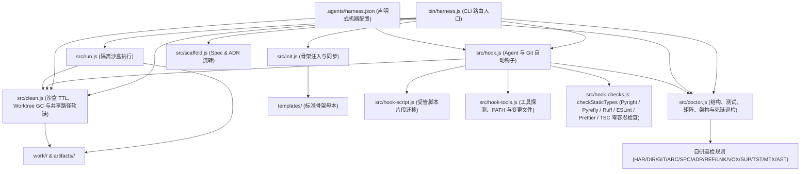
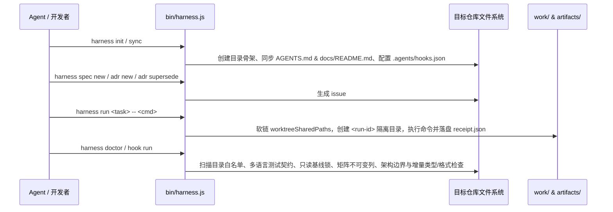

# 全局架构现状 (Architecture Overview)

## 1. 模块边界与源码地图

`yoryon-harness` 由**静态模板母本（`templates/`）**与**零依赖运行时 CLI（`bin/` + `src/`）**两部分组成：

- [bin/harness.js](../../bin/harness.js)：CLI 命令解析与子命令分发路由，不包含具体文件系统状态修改逻辑。
- [src/init.js](../../src/init.js)：负责 `harness init` 与 `harness sync`，从 [templates/](../../templates) 读取母本并向目标仓库写入目录、通用规范及 Git / `.agents/hooks.json` 守护钩子。
- [src/doctor.js](../../src/doctor.js)：负责 `harness doctor` 与 `harness rule`，结合 `git ls-files -co --exclude-standard` 动态感知忽略规则，执行目录契约与防污染白名单（`HAR001`/`DIR001`）、生命周期位置（`SPC001`/`ADR001`/`ADR002`）、三列索引（`REF001`）、多语言测试命名与反 Mock/超时/只读基线锁契约（`TST001`~`TST004`）、矩阵不可变列保护（`MTX001`）、声明式架构边界守卫（`AST001`/`AST002`）及 Markdown 本地死链/锚点检查（`LNK001`/`LNK002`）。
- [src/hook-script.js](../../src/hook-script.js)：按起止标记替换受管片段，旧版持久化 hook 仅按已发布格式迁移；未知旧片段拒绝覆盖，原文件保持不变。用户前后脚本逐字节保留。
- [src/hook-tools.js](../../src/hook-tools.js) 与 [src/hook-checks.js](../../src/hook-checks.js)：分别封装工具探测、环境与变更文件发现，以及现有静态检查流程。
- [src/hook.js](../../src/hook.js)：负责 `harness hook install` 与 `harness hook run [--agent] [--staged]`，自动归一化多语言工具链 `PATH`（`.venv/bin`、`node_modules/.bin`、`~/.cargo/bin`、`~/.local/bin`），自动配置本地 `git config --local fetch.prune true` 并通过 `gh repo edit <owner>/<repo> --delete-branch-on-merge` 自动开启 GitHub 远端 PR 分支自动删除（未关联 GitHub 或 `gh` 失败时输出提醒且不阻塞本地命令），通过 Git `pre-commit`、`reference-transaction` 与 Agent `Stop` 钩子自动清理过期沙盒产物、悬空 Git worktree 元数据与已合并/上游 `[gone]` 本地分支、自动从 `HEAD` 还原被篡改的 `MTX001` 不可变单元格、运行文档与测试契约巡检及增量代码格式/静态类型/Linter 检查（Pyright/Pyrefly/Ruff/ESLint/Prettier/TSC），拦截违规并驱动模型自修复。
- [src/clean.js](../../src/clean.js)：负责 `harness clean`（含 `--worktrees`）及生命周期钩子触发的 `work/`、`artifacts/` 中间产物 TTL / 数量配额清理，基于 `.agents/harness.json` `worktreeSharedPaths` 在子 worktree 中自动软链主仓共享路径，以及基于 `<common_git_dir>/worktrees/*/gitdir`、`.git/index.lock` 锁探活与 mtime 冷却窗口的孤儿 worktree 空壳目录、`.git/worktrees/` 悬空元数据、已合并或上游远端已删除（`[gone]`）的本地分支与干净子 worktree、项目环境注册表失效 `environments` 条目回收。
- [src/run.js](../../src/run.js)：负责 `harness run`，接管验收命令的隔离沙盒目录创建、子 worktree 共享路径自动软链、工具链环境变量注入与回执落盘。
- [src/scaffold.js](../../src/scaffold.js)：负责 `harness spec new`、`harness adr new` 与 `harness adr supersede` 的确定性文档流转。

## 2. 核心执行链路与数据流

## 3. 系统不变量与边界约束

1. **非破坏性初始化与同步（[`src/init.js`](../../src/init.js)）**：
   - `harness init` 在未传 `--force` 时，严禁覆盖目标仓库已有的任何文件；`.gitignore` 采用按行去重追加策略确保 `work/` 与 `artifacts/` 被忽略。
   - `harness sync` 仅覆盖更新通用协议文件（`AGENTS.md` 与 `docs/README.md`）并同步确保 `.git/hooks/` 与 `.agents/hooks.json` 守护钩子就绪，绝不触碰项目特异文件（`README.md`、`PROJECTS.md`、`CHANGELOG.md`、`docs/architecture/`、`docs/reference/INDEX.md`、`.agents/harness.json`）。
2. **结构、反作弊与架构完备性（[`src/doctor.js`](../../src/doctor.js)）**：
   - `DIR001`：`docs/` 下严格只允许 `README.md` 及 5 个标准子目录（`architecture/`、`spec/`、`adr/`、`runbooks/`、`reference/`）；仓库根目录严禁散落未授权二进制截图、压缩包或临时脚本。默认根目录仅保留 `.git`、`.agents`、`bin`、`src`、`docs`、`tests`、`work`、`artifacts`、`experiments`、`dist`；项目、框架及编辑器目录必须在 `.agents/harness.json` 的 `rootAllowlist` 中显式声明（支持名称和 glob），不由核心代码预置技术栈。根目录检查仍遵循 Git 忽略规则；递归内容扫描的依赖/缓存排除名单不构成根目录放行权限。`worktreeSharedPaths` 作为项目显式共享路径声明继续放行对应顶层目录。文件白名单与 `docs/` 子目录规则不变。
   - `SPC001`、`ADR001` / `ADR002`、`REF001`、`LNK001` / `LNK002`：强制保证 Spec/ADR 生命周期位置、参考资料索引登记与本地链接/锚点精确匹配。
   - `TST001` ~ `TST004`：`tests/` 下严禁阶段/序号命名测试文件，Python（`class Test<Subject>:` + `def test_<scenario>_<expected>()`）与 TS/JS（`describe("Test<Subject>", ...)` + `it("test_<scenario>_<expected>", ...)`）对称强制层级与两段式命名；严禁业务 Mock（`TST002`）；锁定 `.agents/harness.json` `protectedPaths` 只读裁判基线（`TST003`）；强制测试内 `subprocess.run` / `spawnSync` / `execSync` 显式传入 `timeout`（`TST004`）。
   - `MTX001`、`AST001` / `AST002`：按 `.agents/harness.json` 锁定 CSV/TSV `immutableColumns` 不可篡改，以及声明式分层依赖方向与核心目录禁用字面量正则。
3. **Agent Stop 钩子、只读回合放行、矩阵自动还原与增量类型/格式门禁（[`src/hook.js`](../../src/hook.js) & [`src/hook-tools.js`](../../src/hook-tools.js)）**：
   - `harness hook run --agent` 仅在正常回合结束（`terminationReason == "NO_TOOL_CALL"`）时执行拦截；若通过 `stdin` 传入的 `transcriptPath`（或 `toolCall`）判定当前回合仅包含只读操作（无工具调用、仅调用只读工具/只读 Shell 命令、或修改类工具调用均以 `ERROR` 终止），直接输出 `{"decision":"stop"}` 放行，跳过沙盒清理与静态检查；遇到 `MTX001` 违规时自动从 `HEAD` 还原不可变列单元格并注入告警；支持 `--staged` 增量检查 Python `ruff format --check` 与 JS/TS `prettier --check`。
4. **隔离沙盒运行与回执落盘（[`src/run.js`](../../src/run.js)）**：
   - `harness run` 在 `work/<run-id>/` 与 `artifacts/<run-id>/` 隔离目录中执行验收命令并生成 `receipt.json` 审计回执。
5. **Worktree 物理目录回收边界、分支合并校验与并发活跃度守卫（[`src/clean.js`](../../src/clean.js)）**：
   - 回收失效 worktree 前强制检查 `.git/index.lock` 等锁文件与 mtime 冷却窗口，且仅允许删除严格位于 `worktreeContainerDirs` 容器内部且无有效 `.git` 链接的物理目录；对上游远端已删除（`[gone]`）的本地分支与关联干净 worktree，强制通过 `git for-each-ref --merged` 或 `git merge-tree --write-tree` 校验分支改动已合入主分支后才允许移除，防止未合并本地提交丢失引用。
