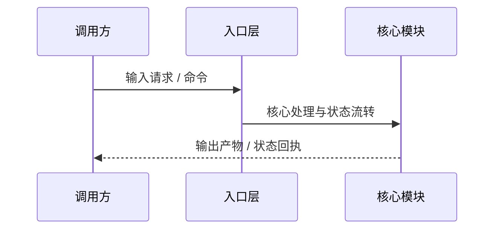

# 全局架构现状 (Architecture Overview)

> 本文件仅维护全局主干（两张 Mermaid 图 + 一组核心约束）。具体子系统或领域细节请在 `docs/architecture/` 下按需平铺新建专题 `.md` 文件。

## 1. 模块边界与源码地图

- **入口层**：<!-- 链接到真实源码路径，一句话说明管什么、不管什么 -->
- **核心模块**：<!-- 链接到真实源码路径，一句话说明管什么、不管什么 -->

## 2. 核心执行链路与数据流

- **关键数据结构**：<!-- 指明核心状态、Schema 或关键类型在源码中的定义位置 -->

## 3. 系统不变量与边界约束

- <!-- 列出不可违反的系统级不变量、状态机约束或并发/存储边界，并链接到对应源码位置 -->
